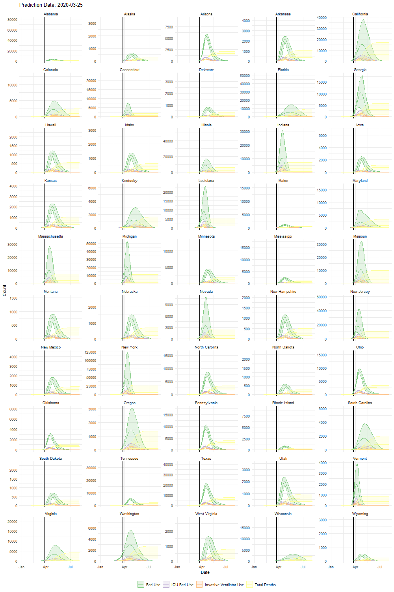

# ihme

Animations showing how the Institute for Health Metrics and Evaluation (IHME) COVID-19 projections for US states changed from one release to the next, in the first weeks of the pandemic: 25 March to 20 April 2020.

## Why this exists

In spring 2020, IHME's model of COVID-19 hospital use and deaths was among the most widely cited forecasts in the United States, and it shaped public and policy discussion. IHME released a new version every few days, and each one could look quite different from the last. Comparing one release to another was hard, because each release replaced the one before it on IHME's site.

This repository saves every release published up to 20 April 2020 and animates them. Each frame is one release. The vertical line marks the release date, and the shaded bands are IHME's uncertainty intervals. Watching the frames shows how much the projected curves for bed use, ICU beds, invasive ventilators and total deaths moved as new data came in and the model was revised.

## What's here

| Path | Contents |
|---|---|
| `images/US.gif` | All 50 states on one animated panel (DC is left out of this panel) |
| `images/<state>.gif` | One animation per state and DC |
| `IHME COVID19 Animation 2020-04-22.html` | Web page with every animation, rendered 22 April 2020 (download it and open it in a browser; GitHub shows only its source) |
| `IHME COVID19 Animation Maker.Rmd` | R Markdown that downloads the IHME releases, combines them and draws the animations |
| `IHME COVID19 Animation.Rmd` | R Markdown for the web page |
| `IHME COVID19 Animation Maker 2020-04-22.html`, `*.md` | Rendered output of the two R Markdown files from the 22 April 2020 run |
| `source_data/` | IHME's release files exactly as downloaded, one zip per release (see below) |

### IHME releases saved in `source_data/`

Each zip is named after the release date shown on IHME's download page. Inside, the folder name is IHME's own model version. `latest.zip` is the release that was current on 22 April 2020: model version `2020_04_20.02`.

| Zip | IHME model version |
|---|---|
| `March 25, 2020.zip` | `ihme-covid19` (first public release) |
| `March 26, 2020.zip` | `2020_03_26` |
| `March 27, 2020.zip` | `2020_03_27` |
| `March 29, 2020.zip` | `2020_03_29` |
| `March 30, 2020.zip` | `2020_03_30` |
| `March 31, 2020.zip` | `2020_03_31.1` |
| `April 1, 2020.zip` | `2020_04_01.2` |
| `April 5, 2020.zip` | `2020_04_05.05.us` |
| `April 7, 2020.zip` | `2020_04_05.08.all` |
| `April 8, 2020.zip` | `2020_04_07.06.all` |
| `April 10, 2020.zip` | `2020_04_09.04` |
| `April 13, 2020.zip` | `2020_04_12.02` |
| `April 17, 2020.zip` | `2020_04_16.05` |
| `latest.zip` | `2020_04_20.02.all` |

These are IHME's model outputs for whole states and countries, not data about individual people. Each zip includes IHME's own description of the variables (`readme.txt` or an information sheet PDF).

## Running the code

The code was written in R in April 2020 (the R and package versions were not recorded) and uses tidyverse, xml2, rvest, foreach, doParallel, gganimate and usmap. Open `IHME COVID19.Rproj` in RStudio and knit `IHME COVID19 Animation Maker.Rmd`, then `IHME COVID19 Animation.Rmd`.

**It probably won't run as written today.** The first step scrapes IHME's 2020 download page (`http://www.healthdata.org/covid/data-downloads`) and downloads every release linked there. IHME has reorganised its site since then. The saved files in `source_data/` are the record. To redraw the animations from them, skip the download loop and build the list of files from `source_data/` instead.

## Licence

There are two parts, under different terms.

**My code, animations and web page** (everything except `source_data/`): Copyright 2020 Venkatesh L. Murthy, MD, PhD. Licensed under the [Creative Commons Attribution-ShareAlike 4.0 International licence (CC BY-SA 4.0)](https://creativecommons.org/licenses/by-sa/4.0/legalcode).

**IHME's data** (`source_data/`, and the numbers plotted in the animations): these belong to IHME and are **not** covered by the CC BY-SA licence above. They are included unchanged as a historical record, under IHME's own terms. When the files were released, IHME made them free to download with the citation below, under the [IHME Terms and Conditions](https://www.healthdata.org/about/terms-and-conditions). Those terms allow non-commercial use. For commercial use, contact IHME.

Anyone reusing the animations is reusing IHME's projections too, so cite IHME as well as this repository:

> Institute for Health Metrics and Evaluation (IHME). COVID-19 Hospital Needs and Death Projections. Seattle, United States of America: Institute for Health Metrics and Evaluation (IHME), University of Washington, 2020.

IHME did not make, review or endorse these animations.
